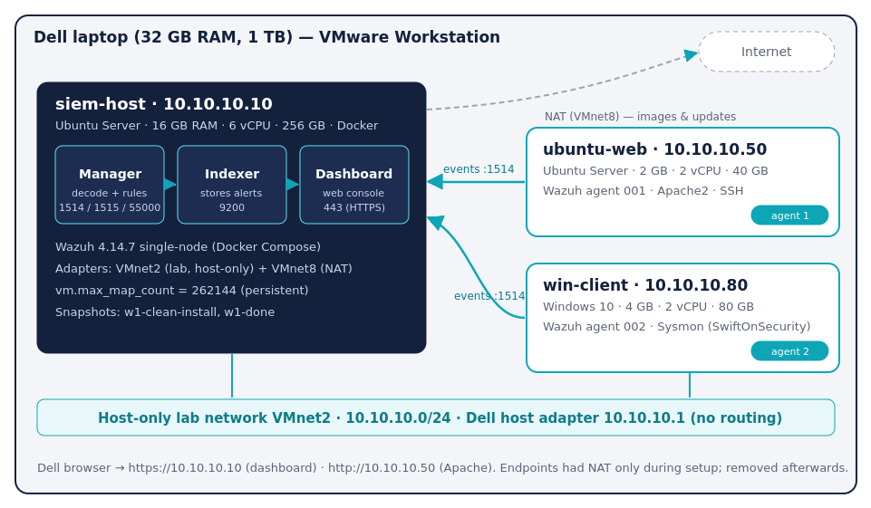
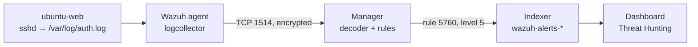

# LabShop Mini-SOC in a box

   

A 12-week Blue Team capstone: building a small Security Operations Centre for **LabShop**, a tiny online shop with one web server, one staff PC and no monitoring. Everything runs on one Dell laptop in an isolated VMware lab.

**Week 1 status: complete.** Three VMs, Wazuh 4.14.7 single-node in Docker, two active agents (Linux + Windows/Sysmon), five verified detections.

📄 Full report: [English](docs/Week1_Report_EN.pdf) · [Azərbaycanca](docs/Week1_Report_AZ.pdf)

---

## Contents
- [Architecture](#architecture)
- [Versions](#versions)
- [Starting and stopping the lab](#starting-and-stopping-the-lab)
- [Week 1 requirements](#week-1-requirements)
- [Five known events (V1)](#five-known-events-v1)
- [Path of an event (V2)](#path-of-an-event-v2)
- [Idle memory per container (W5)](#idle-memory-per-container-w5)
- [Persistence test (W4)](#persistence-test-w4)
- [Security and hygiene (S1, S2)](#security-and-hygiene-s1-s2)
- [Repository layout](#repository-layout)

## Architecture



| Machine | Role | IP | RAM | vCPU | Disk | Network |
|---|---|---|---|---|---|---|
| siem-host | Wazuh in Docker | 10.10.10.10 | 16 GB | 6 | 256 GB | VMnet2 + NAT |
| ubuntu-web | Linux endpoint, Apache, SSH | 10.10.10.50 | 2 GB | 2 | 40 GB | VMnet2 |
| win-client | Windows endpoint, Sysmon | 10.10.10.80 | 4 GB | 2 | 80 GB | VMnet2 |

Full address table: [architecture/address-table.md](architecture/address-table.md)

Ports: **1514** events · **1515** enrolment · **55000** API · **443** dashboard

## Versions

| Component | Version |
|---|---|
| Wazuh manager / indexer / dashboard | **4.14.7** (wazuh-docker tag `v4.14.7`, single-node) |
| Wazuh agents (ubuntu-web, win-client) | 4.14.7 |
| Docker Engine / Compose | 29.9.1 / v5.6.0 |
| Sysmon | v15.22, schema 4.91, SwiftOnSecurity `sysmonconfig-export.xml` |
| Hypervisor | VMware Workstation |
| Windows | Windows 10 Education — licence/evaluation expiry (`slmgr /xpr`): **TODO: fill in** |

## Starting and stopping the lab

**Start (this order):**
1. Power on **siem-host**. Containers start by themselves (`restart: always`).
2. Check: `cd ~/wazuh-docker/single-node && docker compose ps` → three containers `Up`.
3. Wait 1–2 minutes and open `https://10.10.10.10` from the host browser (accept the self-signed certificate).
4. Power on **ubuntu-web**, then **win-client**. Both agents become **Active**.

**Stop (reverse order):**
1. Shut down **win-client** and **ubuntu-web**.
2. On siem-host: `docker compose stop` — **never** `docker compose down -v` (it deletes the data volumes).
3. `sudo shutdown now` on siem-host.

More: [scripts/lab-start.md](scripts/lab-start.md)

## Week 1 requirements

| ID | Requirement | Status | Evidence |
|---|---|---|---|
| L1 | Three VMs with required resources | ✅ | [01](evidence/lab/01-siem-host-vm-settings.png) · [02](evidence/lab/02-ubuntu-web-vm-settings.png) · [03](evidence/lab/03-win-client-vm-settings.png) |
| L2 | Host-only network, static IPs, NAT only where allowed | ✅ | [04](evidence/lab/04-siem-host-ip-and-ping.png) · [05](evidence/lab/05-ubuntu-web-ip-and-ping.png) · [06](evidence/lab/06-win-client-ipconfig-and-ping.png) |
| L3 | VMs reach each other, dashboard from host, clocks correct | ✅ | [07](evidence/lab/07-dell-host-ping.png) · [08](evidence/lab/08-clocks-synchronized.png) · [12](evidence/wazuh/12-dashboard-home.png) |
| L4 | Docker from official repo, `vm.max_map_count` persistent | ✅ | [09](evidence/lab/09-docker-and-max-map-count.png) · [16](evidence/wazuh/16-after-reboot-containers-up.png) |
| L5 | Snapshots `w1-clean-install` and `w1-done` on every VM | ✅ | Taken in VMware (see journal) |
| W1 | Wazuh 4.14.7 single-node stack up | ✅ | [10](evidence/wazuh/10-compose-ps-4.14.7.png) |
| W2 | Dashboard over HTTPS, certificate warning explained | ✅ | [11](evidence/wazuh/11-certificate-warning.png) · [12](evidence/wazuh/12-dashboard-home.png) |
| W3 | Default admin password changed, not in Git | ✅ | [13](evidence/wazuh/13-default-password-rejected.png) |
| W4 | Stop/start and reboot keep agents and alerts | ✅ | [14](evidence/wazuh/14-compose-stop-start.png) · [15](evidence/wazuh/15-manager-status-after-restart.png) · [16](evidence/wazuh/16-after-reboot-containers-up.png) · [17](evidence/wazuh/17-reboot-uptime-proof.png) · [18](evidence/wazuh/18-agents-active-after-reboot.png) |
| W5 | Idle memory per container recorded | ✅ | [19](evidence/wazuh/19-memory-first-measurement.png) · [20](evidence/wazuh/20-memory-idle-measurement.png) |
| A1 | ubuntu-web agent Active | ✅ | [21](evidence/agents/21-ubuntu-web-agent-install.png) · [22](evidence/agents/22-ubuntu-web-agent-active.png) |
| A2 | win-client agent Active | ✅ | [23](evidence/agents/23-win-client-agent-install.png) · [24](evidence/agents/24-two-agents-active.png) |
| A3 | Sysmon with community config, events in dashboard | ✅ | [25](evidence/agents/25-sysmon-install.png) · [26](evidence/agents/26-sysmon-events-dashboard.png) |
| A4 | Web server on ubuntu-web, opens from host | ✅ | [27](evidence/agents/27-apache-ssh-running.png) · [28](evidence/agents/28-apache-default-page-from-dell.png) |
| V1 | Five known events found | ✅ | [table below](#five-known-events-v1) |
| V2 | Event path explained | ✅ | [below](#path-of-an-event-v2) |
| S1 | No secrets in Git | ✅ | [.gitignore](.gitignore) · [scripts/check-secrets.sh](scripts/check-secrets.sh) |
| S2 | Only siem-host has internet | ✅ | [05](evidence/lab/05-ubuntu-web-ip-and-ping.png) · [06](evidence/lab/06-win-client-ipconfig-and-ping.png) |
| D1–D3 | README, architecture/, evidence/, journal | ✅ | this repo · [journal.md](journal.md) |

## Five known events (V1)

| # | Event | Rule description | Level | Rule ID | Screenshot |
|---|---|---|---|---|---|
| 1 | Failed SSH login (ubuntu-web) | sshd: authentication failed. | 5 | 5760 | [29-failed-ssh-login.png](evidence/verification/29-failed-ssh-login.png) |
| 2 | Command run with sudo (ubuntu-web) | Successful sudo to ROOT executed. | 3 | 5402 | [30-sudo-and-new-user.png](evidence/verification/30-sudo-and-new-user.png) |
| 3 | New local user (ubuntu-web) | New user added to the system. | 8 | 5902 | [30-sudo-and-new-user.png](evidence/verification/30-sudo-and-new-user.png) |
| 4 | Program started on Windows, via Sysmon (`net user`) | Discovery activity executed | 3 | 92031 | [31](evidence/verification/31-sysmon-net-user-event.png) · [32](evidence/verification/32-sysmon-net-user-rule.png) |
| 5 | Failed Windows logon (Event ID 4625) | Logon Failure - Unknown user or bad password | 5 | 60122 | [33](evidence/verification/33-failed-windows-logon-event.png) · [34](evidence/verification/34-failed-windows-logon-rule.png) |

Bonus: repeated wrong passwords raised rule **2502** "User missed the password more than one time" at **level 10**.

## Path of an event (V2)



1. **Event happens** – a wrong SSH password; sshd writes a line to `/var/log/auth.log`.
2. **Agent reads it** – the logcollector module picks up the new line and sends it to the manager on 10.10.10.10:1514 (encrypted).
3. **Manager decodes it** – the raw line is split into fields: program, user, source IP.
4. **Rule matches** – analysisd checks the rules; rule 5760 matches and creates a level 5 alert.
5. **Indexer stores it** – Filebeat ships the alert into the `wazuh-alerts-*` index.
6. **Dashboard shows it** – the alert appears in Threat Hunting.

An agent enrols once over **1515**; events then flow over **1514**. Only events that match a rule with level > 0 become alerts.

## Idle memory per container (W5)

Measured with `docker stats --no-stream`, before any agents were enrolled.

| Container | Start-up | Idle |
|---|---|---|
| wazuh-indexer | 1.522 GiB | 1.454 GiB |
| wazuh-manager | 702.4 MiB | 402.2 MiB |
| wazuh-dashboard | 207.8 MiB | 186.5 MiB |
| **Total** | **~2.4 GiB** | **~2.0 GiB** |

## Persistence test (W4)

- `docker compose stop` → `docker compose start`: no data lost.
- `sudo reboot` of siem-host: containers came back automatically (`restart: always`), `vm.max_map_count` and static IPs persisted.
- Repeated with agents enrolled: after reboot both agents returned to **Active** and earlier alerts were still searchable.
- **Nothing had to be done by hand.** The only rule: never use `docker compose down -v`.

## Security and hygiene (S1, S2)

**S1 – No secrets in Git.** Real passwords live only in a git-ignored `.env` on siem-host (template: [.env.example](.env.example)). Certificates and `internal_users.yml` are ignored too. Run the check from the repo root:

```bash
./scripts/check-secrets.sh
```

**S2 – Isolation.** ubuntu-web and win-client had a NAT adapter only while installing software; it was removed afterwards. Only siem-host keeps NAT for Docker images and updates. win-client's gateway `10.10.10.1` is the host-only adapter of the laptop, which does not route to the internet.

## Repository layout

```
.
├── README.md
├── journal.md
├── .gitignore
├── .env.example
├── architecture/
│   ├── lab-diagram.svg / .png
│   └── address-table.md
├── config/
│   ├── sysctl-99-wazuh.conf
│   └── wazuh-agent/sysmon-localfile.xml
├── docs/
│   ├── Week1_Report_EN.pdf
│   └── Week1_Report_AZ.pdf
├── evidence/
│   ├── README.md          ← what each screenshot proves
│   ├── lab/  wazuh/  agents/  verification/
└── scripts/
    ├── check-secrets.sh
    └── lab-start.md
```

## Rules followed every week
- Attack tools only against my own lab VMs on the isolated network.
- No passwords, keys or certificates in Git.
- Snapshot before and after each week.
- Every claim has evidence.
